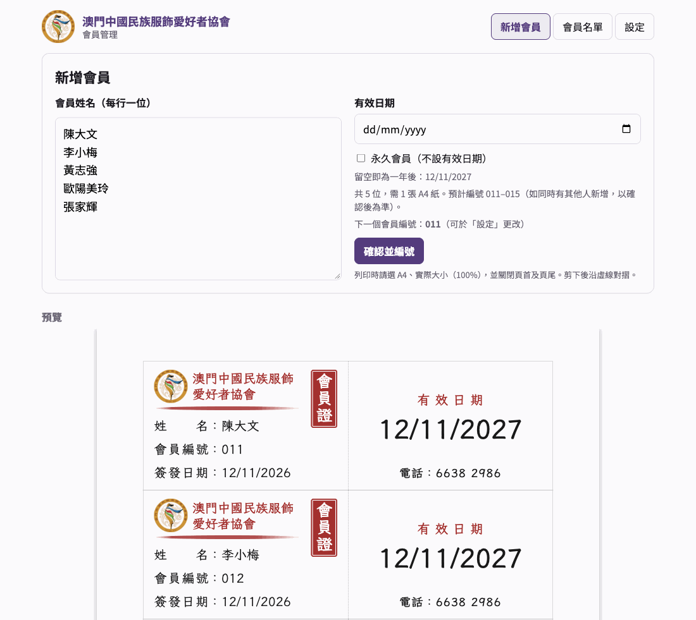

# 會員管理

[](https://github.com/furic/membership-manager/actions/workflows/pages.yml)
[](https://furic.github.io/membership-manager/)
[](LICENSE)


[English](README.md) · 繁體中文

一個給協會、社團使用的小型網頁：共用一份會員名單，自動派發不會重複的會員編號，並以普通 A4 紙列印對摺式會員證（每張 A4 印 5 張，正面與背面並排，剪下後對摺）。



- `site/`：網頁本身。純 HTML/CSS/JS，毋須建置，放在 GitHub Pages。
- `worker/`：Cloudflare Worker 及 D1 資料庫，保存會員名單並派發編號。
- 所有屬於個別協會的資料（名稱、標誌、電話、顏色、語言、日期格式）都放在 `site/config.json` 及 `site/assets/`。
- 介面及會員證提供繁體中文（`zh-Hant`）及英文（`en`）；每多一種語言只需多一個 JSON 檔。

以一般協會的會員人數，兩項服務都在免費額度之內。

現由澳門中國民族服飾愛好者協會使用：https://furic.github.io/membership-manager/

## 使用方法

1. 打開網址，輸入協會共用密碼（同一部電腦只需輸入一次）。
2. **新增會員**：每行輸入一位會員姓名。「有效日期」可留空，留空即為今日起計一年後；有效日期以大字印在卡背。
3. 檢查預覽無誤後，按 **確認並編號**。系統會按次序派發會員編號（001、002……），並存入會員名單。預覽會顯示預計編號，按下後才正式確定。如需由指定編號開始（例如 100），可到 **設定** 更改「下一個會員編號」（必須大於現有最大編號）。
4. 按 **列印**。列印設定請選 **A4**、**實際大小（100%）**，並**關閉頁首及頁尾**。每張 A4 可印 5 張會員證。
5. 沿實線剪下，沿中間虛線對摺：左邊是正面，右邊是背面。
6. **會員名單**：可搜尋姓名或編號；按 **編輯** 可修改會員編號（如編號已被使用會提示）、姓名、有效日期或改為永久會員；亦可永久刪除會員，亦可勾選會員後按 **重印所選**。
7. **設定**：更改下一個會員編號；更改協會共用密碼（需輸入現時密碼，新密碼最少 6 個字元，只可使用英文字母、數字及符號）。更改密碼後，其他電腦須輸入新密碼。

## 為自己的協會架設

需要一個 GitHub 帳戶及一個免費的 Cloudflare 帳戶，約需 20 分鐘。

1. **Fork** 這個 repository。
2. **建立 API**（Cloudflare Worker 及 D1 資料庫）：

   ```sh
   cd worker
   npm install
   npx wrangler login
   npx wrangler d1 create membership          # 將顯示的 database_id 填入 wrangler.toml
   ```

   在 `worker/wrangler.toml` 填上 `database_id`，並將 `ALLOWED_ORIGINS` 設為網頁所在的網址：`https://<你的 GitHub 帳戶名稱>.github.io`（只需 https:// 及網域，不要路徑）。然後：

   ```sh
   npx wrangler d1 migrations apply membership --remote
   npx wrangler secret put PASSCODE           # 第一個共用密碼，之後可在「設定」頁更改
   npx wrangler deploy                        # 會顯示 Worker 的網址
   ```

3. **設定網頁**：修改 `site/config.json`（欄位見下表），將 `apiBase` 設為上一步的 Worker 網址。把協會標誌、印章及網頁圖示放進 `site/assets/`，並以 `logo`、`stamp`、`favicon` 指向這些檔案。
4. **發佈**：在你的 fork 打開 Settings → Pages，將 Source 設為 **GitHub Actions**，然後 push 到 `main`。工作流程會先執行測試，再發佈 `site/`。

push 之前可先在本機試用，見[本機執行](#本機執行)。在網址加上 `?lang=en` 可預覽其他語言。

### 不修改 `config.json`（可選）

如想保留 `site/config.json` 原狀，以免日後從本 repository 拉取更新時出現衝突，可改為把整份設定存成 repository variable：打開 Settings → Secrets and variables → Actions → Variables，新增 `SITE_CONFIG`，貼上整份 JSON。發佈時會先以它覆蓋 `site/config.json`。設定內沒有任何機密：網頁本身是公開的，密碼則是 Worker 的 secret。

### 設定欄位

`site/config.json`。只有 `apiBase` 及 `clubName` 必須填寫，其餘留空即用預設值。

| 欄位 | 預設值 | 用途 |
|---|---|---|
| `apiBase` | | Worker 的網址，例如 `https://membership-api.<帳戶>.workers.dev` |
| `locale` | `"en"` | 介面及會員證的語言，對應 `site/locales/` 內的檔案（`"en"`、`"zh-Hant"`）。`"zh-Hant-MO"` 會退回使用 `zh-Hant.json`。 |
| `clubName` | | 網頁頂部顯示的協會名稱 |
| `cardClubName` | `[clubName]` | 會員證上的協會名稱，每行一個字串，例如 `["澳門中國民族服飾", "愛好者協會"]` |
| `phone` | `""` | 印在每張卡背底部的電話；留空則不印 |
| `logo` | `"assets/logo.png"` | 網頁頂部及卡正面的標誌（正方形） |
| `stamp` | `"assets/stamp.png"` | 卡背的淡色印章水印；`""` 則不印 |
| `favicon` | `"assets/favicon.png"` | 瀏覽器分頁圖示 |
| `cardColor` | `"#a3302f"` | 會員證的主色：協會名稱、印章、筆刷線、有效日期標題 |
| `appColor` | `"#543c7d"` | 網頁的主色：按鈕、分頁、頂部 |
| `numberDigits` | `3` | 會員編號補零至幾位數（`001`） |
| `validityYears` | `1` | 有效日期留空時的預設年期 |
| `dateFormat` | `"DD/MM/YYYY"` | 會員證及名單上的日期格式。可用 `DD`、`D`、`MM`、`M`、`YYYY`，例如 `"MM/DD/YYYY"`、`"YYYY-MM-DD"` |

字型在 `site/index.html` 載入（會員證用霞鶩文楷 LXGW WenKai TC，網頁用 Noto Sans TC），兩者都包含英文字母。

### 新增語言

把 `site/locales/en.json` 複製為 `site/locales/<代碼>.json`（例如 `fr.json`），翻譯各項文字，再設定 `"locale": "<代碼>"`。未翻譯的項目會顯示英文。`{{placeholders}}` 須保持原樣。以 `_one` 結尾的項目是單數形式，數量為 1 時使用。`_cardStyle` 決定會員證版面：`"cjk"` 為直排印章、標籤等寬對齊；`"latin"` 為橫排印章（置於會員編號旁）、姓名過長時自動縮小。

## 技術說明

- 每批新會員都在同一個 D1 transaction 內取號，即使兩人同時新增也不會撞號。
- 設計及計劃文件（為第一個協會而寫）：`docs/superpowers/`。

### 測試

```sh
cd site && npm test                     # 日期、姓名、語言、會員證排版
cd worker && npm install && npm test    # API，包括同時派號及 CORS
```

### 本機執行

```sh
cd worker && npx wrangler d1 migrations apply membership --local && npx wrangler dev   # 需要 worker/.dev.vars，內有 PASSCODE=...
cd site && python3 -m http.server 8080
# 打開 http://localhost:8080/?api=http://127.0.0.1:8787
```

`?api=` 只在 `localhost` 有效，以免有人用特製連結把密碼送到別處。Worker 一律接受 `localhost` 的請求。

### 轉到另一個 Cloudflare 帳戶

在新帳戶重做上面架設步驟的第 2 步，更新 `site/config.json` 的 `apiBase`，然後 push。如網頁網址有變，更新 `worker/wrangler.toml` 的 `ALLOWED_ORIGINS`，再執行一次 `npx wrangler deploy`。

### 密碼

密碼最初是 `PASSCODE` secret。有人在「設定」頁更改密碼後，加鹽的 SHA-256 雜湊會存入 `settings` 資料表（key 為 `passcode`），原本的 secret 隨即失效。如忘記密碼，刪除該行即可退回使用 secret：

```sh
cd worker && npx wrangler d1 execute membership --remote --command "DELETE FROM settings WHERE key = 'passcode'"
```

### 備份

```sh
cd worker && npx wrangler d1 export membership --remote --output members-backup.sql
```

## 授權

[MIT](LICENSE)
